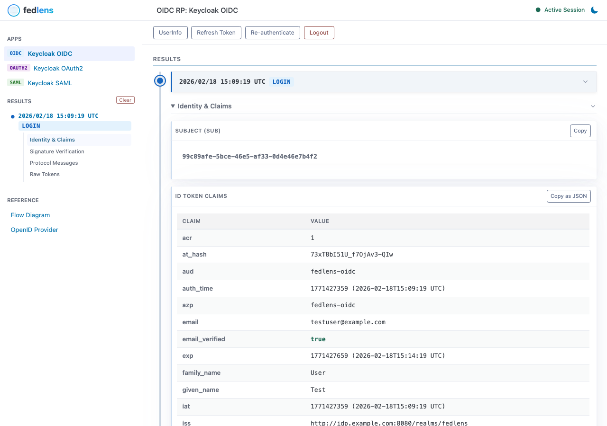
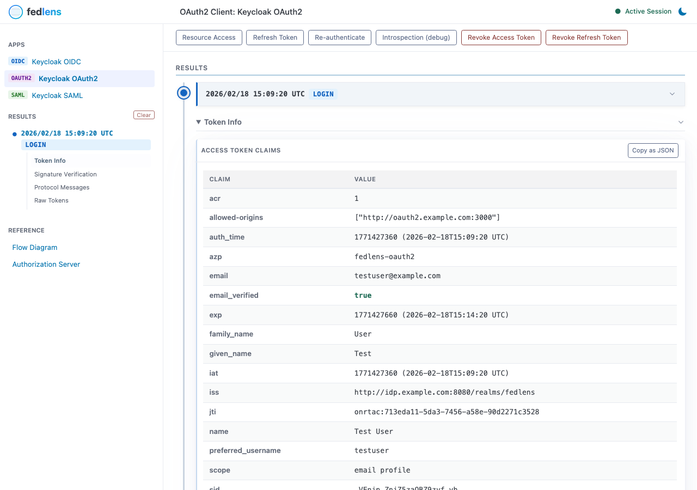
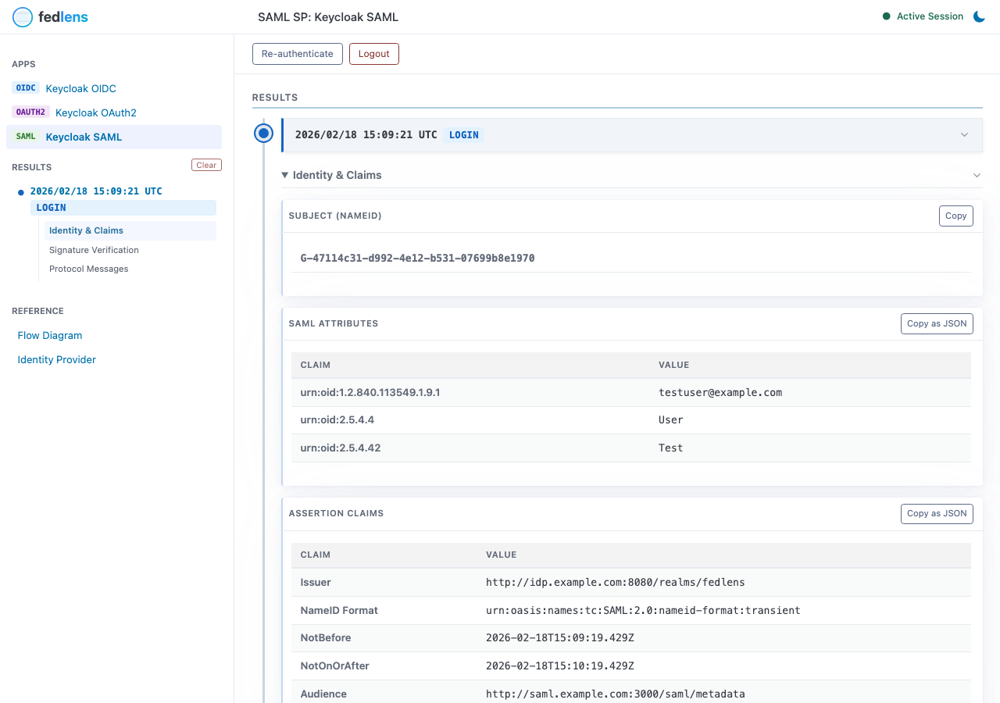

<p align="center">
  
</p>

<p align="center">
  A federation protocol debug tool for <strong>OIDC</strong> and <strong>SAML</strong>.<br>
  Also supports <strong>OAuth2</strong> as a closely related authorization framework.<br>
  fedlens acts as an <strong>OpenID Connect Relying Party</strong>, <strong>OAuth2 Client</strong>, <strong>OAuth2 Resource Server</strong>, and <strong>SAML Service Provider</strong>,<br>
  displaying raw protocol details at every step in a single web UI.
</p>

## Screenshots

**OIDC** — ID Token Claims and Signature Verification:



**OAuth2** — Access Token Claims and Token Introspection:



**SAML** — SAML Attributes and Signature Verification:



## Features

### OIDC (OpenID Connect)

- **Authorization Code Flow** with optional **PKCE** support (S256 / plain)
- **ID Token Claims** and **Access Token Claims** tables with timestamp formatting and boolean highlighting
- **UserInfo** endpoint response display
- **Signature Verification** for ID Token and Access Token (algorithm, key ID, JWKS key matching)
- **Token Refresh Flow** with refresh token rotation detection, and `scope` / `resource` / extra parameters on the refresh request
- **Logout Flow** with configurable `id_token_hint`
- **Request options** behind every action button: [set any authorization, refresh or logout parameter for a single request](#request-options)
- **Re-authentication Profiles** for step-up authentication with custom parameters
- **Custom Scopes**, **Response Mode**, and **Extra Auth Parameters**
- **Protocol Messages** — Authorization Request/Response, Token Request/Response, UserInfo Request/Response with full HTTP capture
- **Raw Tokens** — JWT structure display (Header / Payload / Signature) and opaque token display
- **Reference** — Authorization Code Flow sequence diagram, OpenID Provider endpoints, JWKS public keys, Discovery metadata
- **Results Timeline** — reverse-chronological log of all protocol interactions

### OAuth2

OAuth2 is an authorization framework, not a federation protocol. fedlens includes OAuth2 support to debug Authorization Server interactions — token issuance, introspection, revocation, and resource access — alongside OIDC and SAML flows.

- **Authorization Code Flow** with optional **PKCE** support (S256 / plain)
- **RFC 8414 Discovery** (Authorization Server Metadata) or manual endpoint configuration
- **Access Token Claims** table (when JWT) with boolean highlighting, opaque token detection with introspection guidance
- **Signature Verification** for Access Token (algorithm, key ID, JWKS key matching)
- **Token Refresh Flow** with refresh token rotation detection, and `scope` / `resource` / extra parameters on the refresh request
- **Request options** behind the Login, Re-authenticate and Refresh Token buttons ([see below](#request-options))
- **Token Introspection** (RFC 7662) with HTTP request/response capture
- **Token Revocation** (RFC 7009) for Access Token and Refresh Token independently
- **Resource Access** — built-in Resource Server with separate RS credentials, custom resource URL testing, RFC 9728 Protected Resource Metadata
- **Re-authentication Profiles** for custom authorization parameters
- **Protocol Messages** — Authorization Request/Response, Token Request/Response, Introspection/Revocation Request/Response, Resource Request/Response with full HTTP capture
- **Raw Tokens** — JWT structure display (Header / Payload / Signature) and opaque token display
- **Reference** — Authorization Code Flow and Protected Resource Access sequence diagrams, AS endpoints, JWKS public keys, AS metadata
- **Results Timeline** — reverse-chronological log of all protocol interactions

### SAML

- **SP-Initiated SSO** with HTTP-Redirect and HTTP-POST bindings
- **IdP-Initiated SSO** support (configurable)
- **Identity & Claims** — Subject (NameID), SAML Attributes, and Assertion Claims (Issuer, Audience, AuthnContextClassRef, validity period)
- **NameID** — the received NameID (Format, NameQualifier, SPNameQualifier, SPProvidedID) set beside what the AuthnRequest asked for, so you can see whether the IdP honoured the requested format
- **Encrypted assertions** — shown both as received and decrypted, so the NameID, attributes and signatures stay readable
- **Signature Verification** at both Response and Assertion levels
- **Single Logout (SLO)** — SP-initiated and IdP-initiated with redirect/POST binding support. The SP-initiated LogoutRequest names the principal exactly as the assertion did (NameID attributes and SessionIndex)
- **AuthnRequest options** — NameIDPolicy (Format, AllowCreate, SPNameQualifier), omitting the NameIDPolicy, a Subject NameID hint, `ForceAuthn`, `IsPassive`, `AuthnContextClassRef` and `AssertionConsumerServiceURL`, in the config, a re-authentication profile, or a form behind the button ([see below](#request-options))
- **LogoutRequest options** — override or leave out each NameID attribute and the SessionIndex, to emulate a sloppy SP
- **Re-authentication Profiles** — any AuthnRequest option above, e.g. `ForceAuthn` and `AuthnContextClassRef`
- **External Certificate** support (load from file) or auto-generated self-signed cert
- **Protocol Messages** — AuthnRequest (URL parameters + decoded XML), SAML Response (POST parameters + decoded XML), LogoutRequest/LogoutResponse with binding details
- **Reference** — SP-Initiated SSO and IdP-Initiated SSO sequence diagrams, IdP endpoints, IdP certificates with PEM, IdP Metadata XML
- **Results Timeline** — reverse-chronological log of all protocol interactions

### General

- **Multiple SP/RP** support via TOML configuration with **Tab Navigation**
- **Host-based and Path-based Routing** — multiple instances on same or different hosts
- **TLS Support** with self-signed cert auto-generation or external certificates
- **Dark Mode** toggle with system preference detection (`light` / `dark` / `auto`)
- **Timezone Configuration** for timestamp display (IANA format)
- **Boolean Value Highlighting** in claims tables (true=green, false=red)
- **Syntax Highlighting** for JSON and XML (Prism.js)
- **Copy Buttons** on all code blocks
- **Collapsible Sections** with state persistence
- Single binary, Docker-ready
- Structured logging (`log/slog`) with configurable log level
- Graceful shutdown (SIGINT / SIGTERM)

## Quick Start

### Docker Compose (with Keycloak)

The easiest way to try fedlens is using Docker Compose with a pre-configured Keycloak instance.

**Prerequisites:**

Add the following entries to your `/etc/hosts`:

```
127.0.0.1 idp.example.com oidc.example.com saml.example.com oauth2.example.com
```

**Start:**

```bash
docker compose up
```

**Access:**

- OIDC view: http://oidc.example.com:3000
- OAuth2 view: http://oauth2.example.com:3000
- SAML view: http://saml.example.com:3000
- Keycloak Admin Console: http://idp.example.com:8080 (admin / admin)

**Test user:** `testuser` / `password`

### Build from Source

```bash
make build
```

This runs `templ generate` and then builds the Go binary. The output is a single `fedlens` binary with all static assets embedded.

## Configuration

Set the `CONFIG_FILE` environment variable to point to your TOML file:

```bash
CONFIG_FILE=config.toml ./fedlens
```

See [config.example.toml](config.example.toml) for a full example.

#### Global Settings

| Key | Default | Description |
|---|---|---|
| `listen_addr` | `:3000` | Listen address |
| `insecure_skip_verify` | `false` | Skip TLS certificate verification |
| `log_level` | `info` | Log level (`debug`, `info`, `warn`, `error`) |
| `theme` | `auto` | UI theme (`light`, `dark`, `auto`) |
| `timezone` | `UTC` | IANA timezone for timestamp display (e.g. `Asia/Tokyo`) |
| `tls_cert_path` | | Path to TLS certificate PEM file |
| `tls_key_path` | | Path to TLS private key PEM file |
| `tls_self_signed` | `false` | Auto-generate self-signed TLS certificate |

#### OIDC RP (`[[oidc]]`)

Each `[[oidc]]` block defines a separate OIDC Relying Party.

| Key | Required | Default | Description |
|---|---|---|---|
| `name` | Yes | | Display name (shown in tab) |
| `base_url` | Yes | | Base URL for routing (e.g. `http://oidc.example.com:3000` or `http://localhost:3000/myapp`) |
| `issuer` | Yes | | OIDC Issuer URL |
| `client_id` | Yes | | Client ID |
| `client_secret` | Yes | | Client Secret |
| `redirect_uri` | Yes | | Redirect URI (callback URL) |
| `callback_path` | No | `/callback` | Callback endpoint path (for mocking SaaS RP) |
| `logout_id_token_hint` | No | `true` | Send `id_token_hint` in logout request |
| `auth_request_max_age` | No | `"30m"` | How long a sent authorization request stays valid, i.e. how long you may spend on the IdP login screen before the `state` and PKCE verifier cookies expire |

##### OIDC authorization request (`[oidc.auth_request]`)

What the authorization request carries. The same keys written directly under `[[oidc]]` (the layout before this table existed) still work and log a deprecation warning; setting a key in both places with different values is an error.

| Key | Default | Description |
|---|---|---|
| `scopes` | `["openid", "profile", "email"]` | Requested scopes |
| `pkce` | `false` | Enable PKCE |
| `pkce_method` | `S256` | PKCE method (`S256` or `plain`) |
| `response_type` | `code` | Response type |
| `response_mode` | (default) | Response mode (`query`, `fragment`, `form_post`) |
| `extra_auth_params` | | Extra authorization parameters, e.g. `{ prompt = "consent", max_age = "0" }` |

```toml
[[oidc]]
name = "Keycloak OIDC"
# ... connection settings above the table ...

[oidc.auth_request]
scopes = ["openid", "profile"]
pkce = true
extra_auth_params = { ui_locales = "ja" }
```

Keys that belong to the connection must stay **above** `[oidc.auth_request]`: TOML puts every key after the header inside that table. A key it does not know is reported as unknown at startup rather than dropped silently.

These values are also what the Login and Re-authenticate options forms start with ([see below](#request-options)).

##### OIDC Re-authentication Profiles (`[[oidc.reauth]]`)

Each `[[oidc.reauth]]` block defines a re-authentication profile with custom parameters. Profiles are chosen in the **Re-authenticate options** (the caret next to the Re-authenticate button): the profile's parameters are applied first, and any field you fill in on top overrides them.

| Key | Required | Description |
|---|---|---|
| `name` | Yes | Display name for the reauth button |
| `extra_auth_params` | Yes | Extra auth parameters for re-authentication |

```toml
[[oidc.reauth]]
name = "Step-up Auth"
extra_auth_params = { acr_values = "urn:example:mfa" }
```

#### OAuth2 Client (`[[oauth2]]`)

Each `[[oauth2]]` block defines a separate OAuth2 Client. Unlike OIDC, there is no ID Token or UserInfo — the focus is on Access Token issuance and AS interactions.

| Key | Required | Default | Description |
|---|---|---|---|
| `name` | Yes | | Display name (shown in tab) |
| `base_url` | Yes | | Base URL for routing |
| `issuer` | No* | | RFC 8414 Discovery URL |
| `authorization_url` | No* | | Authorization endpoint URL (manual) |
| `token_url` | No* | | Token endpoint URL (manual) |
| `introspection_url` | No | | Token Introspection endpoint URL |
| `revocation_url` | No | | Token Revocation endpoint URL |
| `client_id` | Yes | | Client ID |
| `client_secret` | Yes | | Client Secret |
| `redirect_uri` | Yes | | Redirect URI (callback URL) |
| `callback_path` | No | `/callback` | Callback endpoint path |
| `resource_urls` | No | | Custom Resource Server URLs to test (e.g. `["https://api.example.com/me"]`) |
| `resource_server_client_id` | No | | Client ID for built-in Resource Server (Token Introspection) |
| `resource_server_client_secret` | No | | Client Secret for built-in Resource Server (Token Introspection) |
| `auth_request_max_age` | No | `"30m"` | How long a sent authorization request stays valid, i.e. how long you may spend on the IdP login screen before the `state` and PKCE verifier cookies expire |

\* Either `issuer` (for RFC 8414 Discovery) or both `authorization_url` + `token_url` (manual) are required.

##### OAuth2 authorization request (`[oauth2.auth_request]`)

Same as `[oidc.auth_request]`, without `response_type` (the authorization code flow is the only one the OAuth2 client speaks). `scopes` defaults to `["profile", "email"]`. The direct keys are deprecated in the same way.

##### OAuth2 Re-authentication Profiles (`[[oauth2.reauth]]`)

Same format as OIDC re-authentication profiles.

#### SAML SP (`[[saml]]`)

Each `[[saml]]` block defines a separate SAML Service Provider.

| Key | Required | Default | Description |
|---|---|---|---|
| `name` | Yes | | Display name (shown in tab) |
| `base_url` | Yes | | Base URL for routing (e.g. `http://saml.example.com:3000` or `http://localhost:3000/myapp`) |
| `idp_metadata_url` | Yes | | IdP Metadata URL |
| `entity_id` | Yes | | SP Entity ID |
| `root_url` | Yes | | SP Root URL |
| `acs_path` | No | `/saml/acs` | Assertion Consumer Service path (for mocking SaaS SP) |
| `slo_path` | No | `/saml/slo` | Single Logout endpoint path |
| `metadata_path` | No | `/saml/metadata` | SP Metadata endpoint path |
| `cert_path` | No | (auto-generated) | Path to SP certificate PEM file |
| `key_path` | No | (auto-generated) | Path to SP private key PEM file |
| `allow_idp_initiated` | No | `false` | Allow IdP-Initiated SSO. Disables InResponseTo validation entirely: any value is accepted, not just an absent one, and the `SubjectConfirmationData` check is skipped as well |
| `authn_request_max_age` | No | `"30m"` | How long a sent AuthnRequest stays valid for InResponseTo validation, i.e. how long you may spend on the IdP login screen |

##### SAML AuthnRequest (`[saml.auth_request]`)

What the AuthnRequest carries. Unset values keep what the SAML library sends (NameIDPolicy with Format `transient` and AllowCreate `true`), so a config without this table sends the same request as before.

| Key | Description |
|---|---|
| `name_id_format` | NameIDPolicy `Format` (a NameID format URI, e.g. `urn:oasis:names:tc:SAML:1.1:nameid-format:emailAddress`). Also advertised in the SP metadata |
| `allow_create` | NameIDPolicy `AllowCreate` (`true` / `false`; omitted when unset in a profile) |
| `sp_name_qualifier` | NameIDPolicy `SPNameQualifier` |
| `omit_name_id_policy` | `true` sends no NameIDPolicy at all, leaving the format to the IdP |
| `subject_name_id` | Adds a `Subject/NameID` to the request as a hint about who is logging in (the SAML counterpart of OIDC `login_hint`) |
| `subject_name_id_format` | `Format` of that hint |
| `force_authn` | `ForceAuthn` |
| `is_passive` | `IsPassive` |
| `authn_context_class_ref` | Asks for this `AuthnContextClassRef` (comparison `exact`) |
| `assertion_consumer_service_url` | `AssertionConsumerServiceURL` the request names. It does not move the endpoint: it tests how the IdP treats a URL that differs from the one in the SP metadata |

```toml
[saml.auth_request]
name_id_format = "urn:oasis:names:tc:SAML:2.0:nameid-format:persistent"
allow_create = false
```

AuthnRequest signing is not enabled, and `ProtocolBinding` is not settable.

##### SAML Re-authentication Profiles (`[[saml.reauth]]`)

Each `[[saml.reauth]]` block defines a re-authentication profile. It takes `name` plus any key of `[saml.auth_request]`; its values override the table's for that profile.

| Key | Required | Description |
|---|---|---|
| `name` | Yes | Display name of the profile |
| (any `[saml.auth_request]` key) | No | e.g. `authn_context_class_ref`, `force_authn`, `name_id_format` |

```toml
[[saml.reauth]]
name = "MFA"
authn_context_class_ref = "urn:oasis:names:tc:SAML:2.0:ac:classes:PasswordProtectedTransport"
force_authn = true
```

#### Example: Multiple SP/RP

```toml
listen_addr = ":3000"
log_level = "debug"
# theme = "dark"
# timezone = "Asia/Tokyo"
# tls_self_signed = true

[[oidc]]
name = "Keycloak OIDC"
base_url = "http://kc-oidc.example.com:3000"
issuer = "https://keycloak.example.com/realms/test"
client_id = "fedlens"
client_secret = "secret"
redirect_uri = "http://kc-oidc.example.com:3000/callback"
pkce = true

[[oidc]]
name = "Entra ID"
base_url = "http://entra-oidc.example.com:3000"
issuer = "https://login.microsoftonline.com/xxx/v2.0"
client_id = "yyy"
client_secret = "zzz"
redirect_uri = "http://entra-oidc.example.com:3000/callback"
extra_auth_params = { login_hint = "user@example.com" }

[[saml]]
name = "Keycloak SAML"
base_url = "http://kc-saml.example.com:3000"
idp_metadata_url = "https://keycloak.example.com/realms/test/protocol/saml/descriptor"
entity_id = "http://kc-saml.example.com:3000/saml/metadata"
root_url = "http://kc-saml.example.com:3000"

[[saml]]
name = "Okta SAML"
base_url = "http://okta-saml.example.com:3000"
idp_metadata_url = "https://okta.example.com/app/xxx/sso/saml/metadata"
entity_id = "http://okta-saml.example.com:3000/saml/metadata"
root_url = "http://okta-saml.example.com:3000"

[[oauth2]]
name = "GitHub OAuth"
base_url = "http://github-oauth.example.com:3000"
authorization_url = "https://github.com/login/oauth/authorize"
token_url = "https://github.com/login/oauth/access_token"
client_id = "your-github-client-id"
client_secret = "your-github-client-secret"
redirect_uri = "http://github-oauth.example.com:3000/callback"
scopes = ["read:user", "user:email"]
```

This produces tabs: `Keycloak OIDC` | `Entra ID` | `GitHub OAuth` | `Keycloak SAML` | `Okta SAML`

## Request Options

Every action button that sends a request has a caret (`▾`) beside it. The button alone sends the request as configured; the caret opens a form that changes **that one request**, and the number on the caret counts what you changed. The options are sent when the button itself is pressed.

How the forms behave, the same everywhere:

- **The form shows the request as it will be sent.** Fields start with the config file's values (and, where the library or fedlens supplies a default, with that value), so there is no hidden default behind a blank field.
- **A field you leave alone overrides nothing.** In particular it does not undo a re-authentication profile.
- **A field you change overrides** the config, and says so next to its label (`overrides config`; `overrides login` on the SAML Logout form, whose values come from the login).
- **A field you empty is not sent.** Emptying a value that was prefilled takes that parameter out of the request (`config removed`). `scope` is the exception: an authorization request without one is not what is meant, so it cannot be removed.
- **Reset** returns the fields to their starting values.
- **Re-authenticate** has a **Profile** select at the top. The profile is applied first and the fields below override it; a field that holds the profile's value shows it faintly (`profile`).
- The fields are remembered per page for the browser session, so they survive switching tabs.

| Button | Fields |
|---|---|
| OIDC **Login** / **Re-authenticate** | `scope`, `response_mode`, `prompt`, `login_hint`, `max_age`, `acr_values`, `ui_locales`, `id_token_hint`, `claims`, and an *Extra parameters* box (one `key=value` per line, applied last, so it can override a field) |
| OAuth2 **Login** / **Re-authenticate** | `scope`, `response_mode`, and the *Extra parameters* box |
| OIDC / OAuth2 **Refresh Token** | `scope` (a subset of what was granted, RFC 6749 6), `resource` (RFC 8707), and the *Extra parameters* box, e.g. `audience=my-api`. All start empty, so an untouched refresh sends only the grant |
| OIDC **Logout** | `post_logout_redirect_uri`, `logout_hint`, `ui_locales`, `state`, `id_token_hint` (`send` / `omit`), and the *Extra parameters* box |
| SAML **Login** / **Re-authenticate** | `NameIDPolicy Format`, `AllowCreate`, `SPNameQualifier`, `Omit NameIDPolicy`, `Subject NameID` (+ its Format), `ForceAuthn`, `IsPassive`, `AuthnContextClassRef`, `AssertionConsumerServiceURL` |
| SAML **Logout** | `NameID`, `NameID Format`, `NameQualifier`, `SPNameQualifier`, `SPProvidedID`, `SessionIndex` |

The SAML Logout form starts with the values a correct SP would send: the NameID exactly as the assertion carried it, with the attributes it did not carry left out, and the SessionIndex of the login. Changing or emptying them emulates an SP that gets it wrong, for example one that sends a NameID with the wrong `Format`, or no `SessionIndex` (which asks the IdP to end every session). `Reason` and `NotOnOrAfter` of the LogoutRequest are not settable.

The request that was actually sent is shown in the result's **Protocol Messages**: the authorization URL, the token request parameters, the AuthnRequest XML, and the LogoutRequest XML.

## How It Works

fedlens runs a single HTTP server that routes requests based on `base_url` (host + optional path prefix):

- Each `[[oidc]]` entry creates an OIDC RP handler bound to its `base_url`
- Each `[[oauth2]]` entry creates an OAuth2 Client handler bound to its `base_url`
- Each `[[saml]]` entry creates a SAML SP handler bound to its `base_url`
- **Host-based**: `base_url = "http://oidc.example.com:3000"` → routes by host only
- **Path-based**: `base_url = "http://localhost:3000/myapp"` → routes by host + path prefix (no `/etc/hosts` needed)

On startup, fedlens fetches OIDC discovery metadata, OAuth2 authorization server metadata (RFC 8414), and SAML IdP metadata, making them available on the pre-login screen. After authentication, all protocol exchange details (tokens, assertions, signatures) are displayed.

### `base_url` and TLS Deployment Patterns

The `base_url` field specifies the **externally visible URL** (scheme + host + optional path). The scheme in `base_url` does not affect how fedlens listens — it is used for routing, navigation links, and cookie flags.

Behind a TLS-terminating proxy, `base_url` must therefore say `https://`, not the plain HTTP that fedlens itself receives. Cookie `Secure` and `SameSite` are derived from it rather than from `X-Forwarded-Proto`, so an `http://` base URL behind an HTTPS front makes fedlens mark its cookies as insecure and `SameSite=Lax` — and the browser will then drop them on the cross-site POST that carries a SAML Response or a `form_post` callback. The same setting also determines the ACS URL published in the SP metadata and the OIDC `redirect_uri`, so getting it wrong breaks more than cookies.

#### Pattern 1: Plain HTTP (development)

```toml
listen_addr = ":3000"

[[oidc]]
base_url = "http://localhost:3000/keycloak"
```

#### Pattern 2: TLS terminated by fedlens

```toml
listen_addr = ":443"
tls_self_signed = true    # or tls_cert_path / tls_key_path

[[oidc]]
base_url = "https://oidc.example.com"
```

#### Pattern 3: TLS terminated by reverse proxy (nginx, etc.)

The reverse proxy handles TLS and forwards plain HTTP to fedlens. Set `base_url` to the **external** `https://` URL. Ensure the proxy sets `X-Forwarded-Proto: https` so that fedlens correctly sets the `Secure` flag on cookies.

```toml
listen_addr = ":3000"    # fedlens listens on plain HTTP

[[oidc]]
base_url = "https://oidc.example.com"    # external URL seen by browsers
```

```nginx
server {
    listen 443 ssl;
    server_name oidc.example.com;

    proxy_set_header Host $host;
    proxy_set_header X-Forwarded-Proto https;

    location / {
        proxy_pass http://fedlens:3000;
    }
}
```

### Exporting a flow

Once a timeline has entries, an **Export** link appears above them in the
sidebar. It downloads `GET {base_url}/export`: the same page rendered as a
standalone HTML file, with the stylesheets and syntax highlighter inlined and
every interactive control removed. One file, no accompanying directory, opens
from the filesystem on any machine — which browser "Save As" does not reliably
give you.

Use it to hand a colleague the exact protocol exchange: the raw SAML XML, the
decoded tokens, the signature verification results, and the whole timeline,
exactly as fedlens rendered them.

> **The exported file contains live credentials** — access tokens, refresh
> tokens, and the full assertion — because that is what you were looking at. The
> file carries a banner saying so. Refresh tokens in particular can stay valid
> for days or months, so treat the file as a secret before attaching it to a
> ticket.

### Deployment: single instance only

fedlens keeps the debug timeline and the OIDC/OAuth2 tokens in memory, keyed by
the `saml_debug_id`, `oidc_debug_id` and `session_id` cookies. **Run exactly one
instance**, or pin each browser to one instance with session affinity.

Login itself survives being spread across instances — `state`, the PKCE
verifier, the SAML request tracker and the SAML session are all carried in
cookies, so authentication completes wherever the request lands. What breaks is
everything that reads the in-memory state:

| Behaviour with more than one instance | |
|---|---|
| OIDC/SAML login, `InResponseTo` validation | Works — cookie-based |
| Debug timeline | Fragments; the SAML ACS falls back to treating the response as IdP-initiated and starts a new timeline |
| Token Refresh / Introspection / Revocation / UserInfo | Fail silently — the handler finds no session and redirects back to the index, so the button appears to do nothing |

If you must scale out, enable session affinity on those cookies — on an AWS ALB
that is target group stickiness with `app_cookie`. Note that affinity does not
survive a deployment: replacing the tasks discards every timeline.

## Development

```bash
# Build (generate templ + compile)
make build

# Development mode (generate + run)
make dev

# Run unit tests
make test

# Run E2E tests (requires Docker)
make e2e

# Clean build artifacts
make clean
```

### E2E Tests

E2E tests use [Playwright](https://playwright.dev/) and run against Chromium, Firefox, and WebKit.

```bash
# Setup (first time)
cd e2e && pnpm install && pnpm exec playwright install && cd ..

# Run all E2E tests
make e2e
```

#### Playwright Selectors

The HTML is designed for easy E2E testing. Use the `id` attributes to scope into a specific result entry or section, then use `getByTestId()` to select value cells.

These selectors are a **stable contract**: fedlens is meant to be driven from your own Playwright suite to test your IdP, so the `id` and `data-testid` values below are treated as public API and will not be renamed without a major version bump.

One deliberate inconsistency: each protocol's rows are named the way that protocol names them. OIDC and OAuth2 errors use the OAuth 2.0 parameter names (`error`, `error_description`), while SAML errors use the SAML element names (`StatusCode`, `Detail`). Rows rendered through `toTestID()` — Signature Verification and Response Details — are always snake_case regardless of protocol.

**Scoping by `id`**

| Selector | Scope |
|---|---|
| `#result-0` | First (most recent) result entry |
| `#result-0-claims` | Identity & Claims section (contains sub-tables below) |
| `#result-0-id-token-claims` | ID Token Claims table (OIDC) |
| `#result-0-access-token-claims` | Access Token Claims table (OIDC) |
| `#result-0-userinfo-claims` | UserInfo Claims table (OIDC) |
| `#result-0-nameid` | SAML NameID table (NameID, Format, qualifiers, and the comparison with what was requested) |
| `#result-0-attributes` | SAML Attributes table |
| `#result-0-sigs` | Signature Verification section |
| `#result-0-response` | SAML Response Details section |
| `#result-0-protocol` | Protocol Messages section |
| `#result-0-tokens` | Raw Tokens section (OIDC) |
| `#result-0-error` | Error Details section |

**`data-testid` on action buttons**

The action bar buttons have fixed `data-testid` attributes. Visibility depends on session state.

| `data-testid` | Element | Protocol | Shown when |
|---|---|---|---|
| `login-btn` | Login button | OIDC / OAuth2 / SAML | No session |
| `logout-btn` | Logout button | OIDC / OAuth2 / SAML | Active session |
| `userinfo-btn` | UserInfo button | OIDC only | Active session + UserInfo endpoint configured |
| `introspection-btn` | Introspection button | OIDC / OAuth2 | Active session + Introspection endpoint configured |
| `revoke-at-btn` | Revoke Access Token button | OIDC / OAuth2 | Active session + Revocation endpoint configured |
| `revoke-rt-btn` | Revoke Refresh Token button | OIDC / OAuth2 | Active session + Revocation endpoint + refresh token present |
| `resource-access-btn` | Resource Access button | OAuth2 | Resource Server configured (built-in RS requires `resource_server_client_id`) |
| `refresh-btn` | Refresh Token button | OIDC / OAuth2 | Active session + refresh token present |
| `reauth-btn` | Re-authenticate button | OIDC / OAuth2 / SAML | Active session |
| `reauth-options-toggle` | Caret that opens the Re-authenticate options | OIDC / OAuth2 / SAML | Active session |
| `reauth-opt-profile` | Select for a `[[*.reauth]]` profile (value is its 0-based index; empty = none) | OIDC / OAuth2 / SAML | Inside the options, when profiles are configured |
| `refresh-options-toggle` | Caret that opens the Refresh Token options | OIDC / OAuth2 | Active session + refresh token present |
| `logout-options-toggle` | Caret that opens the Logout options | OIDC / SAML | Active session |
| `login-options-toggle` | Caret that opens the Login options | OIDC / OAuth2 / SAML | No session |
| `<button>-opt-<field>` | One field of that button's options, e.g. `login-opt-prompt`, `login-opt-login_hint`, `refresh-opt-scope`, `refresh-opt-extra`, `logout-opt-post_logout_redirect_uri`, `login-opt-assertion_consumer_service_url`, `logout-opt-session_index` | OIDC / OAuth2 / SAML | Inside the options |
| `options-card` | The card holding the options of every button that has them | OIDC / OAuth2 / SAML | While it is open |
| `options-title` | Heading of the card; names the button whose options are shown | OIDC / OAuth2 / SAML | While the card is shown |
| `<button>-options-panel` | The form of that button's options | OIDC / OAuth2 / SAML | While that button's caret has opened the card |
| `<button>-options-summary` | The "N modified: ..." summary of that button's options | OIDC / OAuth2 / SAML | While that button's caret has opened the card |
| `<button>-options-reset` | Reset that button's options to their starting values | OIDC / OAuth2 / SAML | While that button's options are modified |
| `options-collapse` | Hide the card | OIDC / OAuth2 / SAML | While the card is shown |

The options are sent when the button itself is pressed, so a test sets the fields and then clicks the button.

**`data-testid` on value cells**

All value `<td>` elements have `data-testid` attributes for direct access:

| Category | Naming Convention | Examples |
|---|---|---|
| Claims / Attributes | IdP key as-is | `sub`, `email`, `preferred_username`, `urn:oid:1.2.840.113549.1.9.1` |
| Subject | Fixed | `subject` |
| Error (OIDC) | OAuth 2.0 parameter names | `error`, `error_description`, `error_uri`, `detail` |
| Error (SAML) | SAML element names, as-is | `StatusCode`, `Detail` |
| Signature | Label → `toTestID()` | `verified`, `algorithm`, `key_id_kid`, `key_type_kty` |
| Response Details | Label → `toTestID()` | `issuer`, `status_code`, `destination` |
| Params | Parameter key as-is | `redirect_uri`, `scope`, `response_type` |

The `toTestID()` conversion rule for Signature / Response Details labels:
1. Remove parentheses → `Key ID (kid)` → `Key ID kid`
2. Lowercase → `key id kid`
3. Replace spaces with `_` → `key_id_kid`

**Example: Action button interactions**

```typescript
// Pre-login: click Login
await page.getByTestId('login-btn').click();

// Post-login: trigger actions
await page.getByTestId('userinfo-btn').click();       // OIDC only
await page.getByTestId('refresh-btn').click();         // OIDC only
await page.getByTestId('reauth-btn').click();          // Re-authenticate (default)

// Re-authenticate with a configured profile (index 0) and an extra parameter
await page.getByTestId('reauth-options-toggle').click();
await page.getByTestId('reauth-opt-profile').selectOption('0');
await page.getByTestId('reauth-opt-max_age').fill('0');
await page.getByTestId('reauth-btn').click();

// Refresh with a narrower scope and an extra parameter
await page.getByTestId('refresh-options-toggle').click();
await page.getByTestId('refresh-opt-scope').fill('openid');
await page.getByTestId('refresh-opt-extra').fill('audience=my-api');
await page.getByTestId('refresh-btn').click();

// Leave a prefilled parameter out of the logout request
await page.getByTestId('logout-options-toggle').click();
await page.getByTestId('logout-opt-post_logout_redirect_uri').fill('');
await page.getByTestId('logout-btn').click();
```

**Example: OIDC login assertions**

```typescript
// Subject is unique within #result-0-claims
const claims = page.locator('#result-0-claims');
await expect(claims.getByTestId('subject')).not.toBeEmpty();

// Scope to specific token table to avoid ambiguity (same claim may exist in ID Token, Access Token, UserInfo)
const idTokenClaims = page.locator('#result-0-id-token-claims');
await expect(idTokenClaims.getByTestId('preferred_username')).toHaveText('testuser');
await expect(idTokenClaims.getByTestId('email')).toHaveText('testuser@example.com');

const sigs = page.locator('#result-0-sigs');
await expect(sigs.getByTestId('verified')).toHaveText('true');
```

**Example: SAML login assertions**

```typescript
const claims = page.locator('#result-0-claims');
await expect(claims.getByTestId('subject')).not.toBeEmpty();

const attributes = page.locator('#result-0-attributes');
await expect(attributes.getByTestId('urn:oid:1.2.840.113549.1.9.1')).toHaveText('testuser@example.com');

const sigs = page.locator('#result-0-sigs');
await expect(sigs.getByTestId('verified')).toHaveText('true');

// Did the IdP honour the NameID format the AuthnRequest asked for?
const nameId = page.locator('#result-0-nameid');
await expect(nameId.getByTestId('Result')).toHaveText('matches the requested Format');
```

**Example: Error assertions**

```typescript
// OIDC
const oidcError = page.locator('#result-0-error');
await expect(oidcError.getByTestId('error')).toHaveText('invalid_grant');
await expect(oidcError.getByTestId('error_description')).toContainText('expired');

// SAML (test IDs follow each protocol's own naming, so SAML rows are CamelCase)
const samlError = page.locator('#result-0-error');
await expect(samlError.getByTestId('StatusCode')).toHaveText('saml_validation_failed');
await expect(samlError.getByTestId('Detail')).toContainText('InResponseTo');
```

### Tech Stack

| Component | Technology |
|---|---|
| Language | Go 1.26+ |
| Templates | [templ](https://templ.guide/) (compiled to Go) |
| Dynamic UI | [htmx](https://htmx.org/) 2.0.7 |
| CSS | [Pico CSS](https://picocss.com/) 2.1.1 |
| Syntax Highlighting | [Prism.js](https://prismjs.com/) 1.30.0 |
| Configuration | [TOML](https://toml.io/) (BurntSushi/toml) |
| OIDC | coreos/go-oidc + golang.org/x/oauth2 |
| SAML | crewjam/saml |

## License

Apache License 2.0
